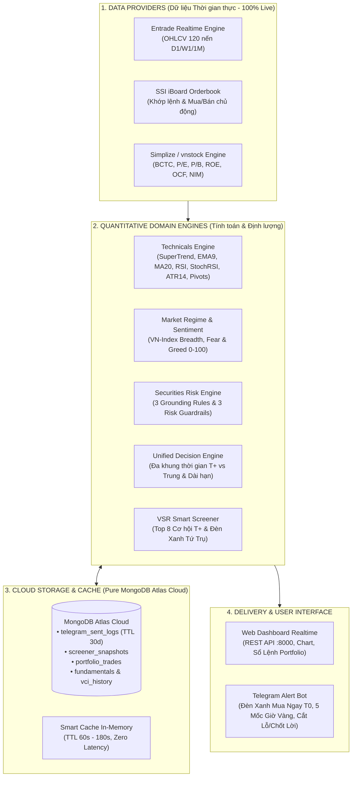
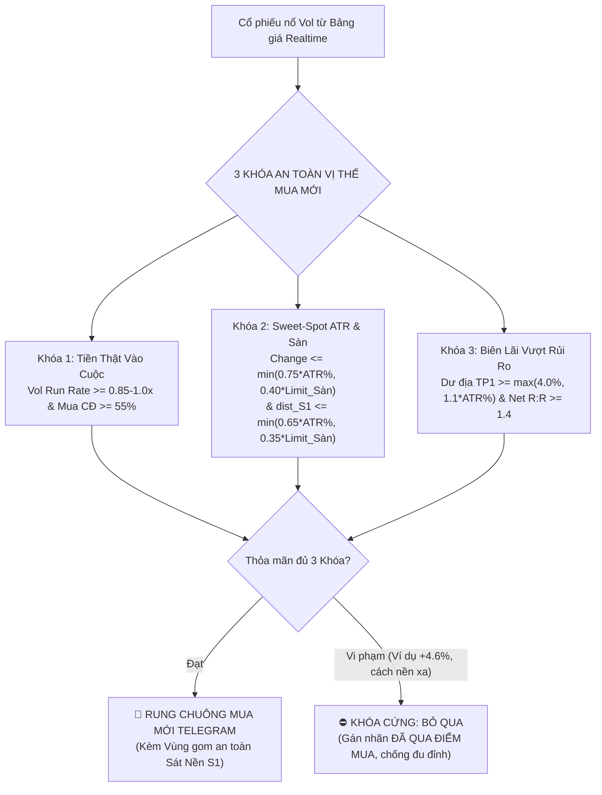

# Hướng Dẫn Thuật Toán Tính Thông Số & Đặc Tả Hệ Thống Stock RT

Tài liệu này giải thích chi tiết **kiến trúc hệ thống**, **cơ chế tính toán các chỉ số kỹ thuật (TA)**, **định giá & sức khỏe tài chính doanh nghiệp (FA)**, **công cụ quản trị rủi ro định lượng (Risk Engine)**, **bộ quy tắc ra quyết định hợp nhất (Unified Decision Engine)** và **hệ thống cảnh báo Telegram tự động (Telegram Alerts Ecosystem)** trong nền tảng **Stock RT (Realtime Analytics & Risk Management)**.

---

## 1. Kiến Trúc Tổng Thể & Luồng Dữ Liệu Thực Tế

Hệ thống được tổ chức theo mô hình **Clean Modular Architecture**, tuân thủ nguyên tắc độc lập giữa tầng thu thập dữ liệu (Providers), tầng nghiệp vụ định lượng (Domain Engines), tầng điều khiển (Controllers), và tầng lưu trữ phân tán đám mây (MongoDB Atlas):



### Bản Đồ Thành Phần Source Code
- **HTTP Server & REST Routing:** [backend/server.py](file:///Users/minhpvl/Desktop/VSCode/stock_rt/backend/server.py)
- **Controllers:**
  - Chi tiết mã & Tổng hợp nến: [backend/controllers/stock_controller.py](file:///Users/minhpvl/Desktop/VSCode/stock_rt/backend/controllers/stock_controller.py)
  - Bộ lọc cổ phiếu & VSR Top T+: [backend/controllers/screener_controller.py](file:///Users/minhpvl/Desktop/VSCode/stock_rt/backend/controllers/screener_controller.py)
  - Sổ lệnh & Gói danh mục: [backend/controllers/portfolio_controller.py](file:///Users/minhpvl/Desktop/VSCode/stock_rt/backend/controllers/portfolio_controller.py)
  - Xu hướng & Tâm lý thị trường: [backend/controllers/market_controller.py](file:///Users/minhpvl/Desktop/VSCode/stock_rt/backend/controllers/market_controller.py)
- **Domain Engines:**
  - Chỉ báo Kỹ thuật & SuperTrend: [backend/domain/technicals.py](file:///Users/minhpvl/Desktop/VSCode/stock_rt/backend/domain/technicals.py)
  - Ra quyết định đa khung thời gian: [backend/domain/decision_engine.py](file:///Users/minhpvl/Desktop/VSCode/stock_rt/backend/domain/decision_engine.py)
  - Bộ lọc Top T+ & Đèn Xanh: [backend/domain/screener_engine.py](file:///Users/minhpvl/Desktop/VSCode/stock_rt/backend/domain/screener_engine.py)
  - Đánh giá Rủi ro Định lượng: [backend/domain/risk_engine.py](file:///Users/minhpvl/Desktop/VSCode/stock_rt/backend/domain/risk_engine.py)
  - Phân loại Thị trường (Regime): [backend/domain/regime.py](file:///Users/minhpvl/Desktop/VSCode/stock_rt/backend/domain/regime.py)
  - Nhóm ngành & Gói đầu tư: [backend/domain/portfolio_bundler.py](file:///Users/minhpvl/Desktop/VSCode/stock_rt/backend/domain/portfolio_bundler.py)
- **Data Providers:**
  - Bảng giá trực tuyến SSI: [backend/data_providers/market_board_provider.py](file:///Users/minhpvl/Desktop/VSCode/stock_rt/backend/data_providers/market_board_provider.py)
  - Lịch sử nến & Intraday Entrade: [backend/data_providers/entrade_provider.py](file:///Users/minhpvl/Desktop/VSCode/stock_rt/backend/data_providers/entrade_provider.py)
  - BCTC & Định giá Simplize/vnstock: [backend/data_providers/fundamental_provider.py](file:///Users/minhpvl/Desktop/VSCode/stock_rt/backend/data_providers/fundamental_provider.py)
- **Database & Telegram Utils:**
  - Pure MongoDB Atlas Database: [backend/db/portfolio_db.py](file:///Users/minhpvl/Desktop/VSCode/stock_rt/backend/db/portfolio_db.py)
  - Telegram Alert Bot Engine: [backend/utils/telegram_bot.py](file:///Users/minhpvl/Desktop/VSCode/stock_rt/backend/utils/telegram_bot.py)
  - Scheduler giám sát danh mục: [backend/utils/portfolio_scheduler.py](file:///Users/minhpvl/Desktop/VSCode/stock_rt/backend/utils/portfolio_scheduler.py)
  - Định nghĩa Ngành nghề & Tứ Trụ: [backend/constants/sectors.py](file:///Users/minhpvl/Desktop/VSCode/stock_rt/backend/constants/sectors.py)

---

## 2. Công Thức & Chỉ Báo Kỹ Thuật (Technical Analysis - TA)

Mọi chỉ báo kỹ thuật được xử lý định lượng trong [backend/domain/technicals.py](file:///Users/minhpvl/Desktop/VSCode/stock_rt/backend/domain/technicals.py) dựa trên chuỗi nến lịch sử thực tế (không dùng mock/giả lập):

### 2.1. Dải Xu Hướng SuperTrend Ribbon (ATR 10, Multiplier 3.0)
SuperTrend đóng vai trò là "la bàn" chỉ báo xu hướng chủ đạo:
- **Biên trên (Upper Band)**: $\text{Basic Upper} = \frac{\text{High} + \text{Low}}{2} + (3.0 \times \text{ATR10})$
- **Biên dưới (Lower Band)**: $\text{Basic Lower} = \frac{\text{High} + \text{Low}}{2} - (3.0 \times \text{ATR10})$
- **Trạng thái dải ruy-băng**:
  - `VÙNG XANH (BULLISH)`: Giá đóng cửa nằm trên Lower Band $\rightarrow$ Nắm giữ / Canh điểm vào lệnh mua.
  - `VÙNG HỒNG (BEARISH)`: Giá đóng cửa nằm dưới Upper Band $\rightarrow$ Xu hướng giảm, hạn chế bắt đáy ngược trend.
  - `ĐẢO CHIỀU MUA (isFlipBuy)`: Phiên đầu tiên giá vượt từ Vùng Hồng sang Vùng Xanh $\rightarrow$ Tín hiệu nổ sóng sớm.

### 2.2. Hệ Thống Đường Trung Bình Động (Moving Averages)
- **EMA9 (Exponential Moving Average 9)**: Đường xung lực cực ngắn hạn, định hình điểm xoay cho các cổ phiếu có dòng tiền mạnh.
- **MA20 (Simple Moving Average 20)**: Đường xu hướng ngắn hạn 1 tháng giao dịch. Giá $> MA20$ là điều kiện tiên quyết cho các lệnh mua T+.
- **MA50 & MA200**: Các ngưỡng hỗ trợ trung và dài hạn cho các quỹ đầu tư tổ chức.

### 2.3. Tỷ Lệ Đột Biến Khối Lượng Quy Chuẩn Phiên (Volume Run-Rate)
Tránh sai số khối lượng vào đầu phiên sáng (khi thị trường mới mở cửa vol còn thấp):
- **Công thức**:
  $$\text{Vol Run-rate} = \frac{\text{Khối lượng khớp hiện tại}}{\text{Vol MA20} \times \text{Tỷ lệ thời gian giao dịch đã trôi qua}}$$
- **Ý nghĩa thực chiến**:
  - `Vol Run-rate >= 1.5x`: Tiền lớn bùng nổ vượt trội (Dấu chân Cá mập).
  - `1.0x - 1.49x`: Thanh khoản tích cực, lực cầu duy trì đều đặn.
  - `0.6x - 0.99x`: Thanh khoản trung tính, tích lũy.
  - `<= 0.6x`: Cạn kiệt nguồn cung, rũ bỏ thành công.

### 2.4. Tỷ Lệ Khớp Lệnh Mua Chủ Động (Active Buy Ratio)
Khai thác trực tiếp từ luồng dữ liệu sổ lệnh SSI iBoard:
$$\text{Buy Ratio} = \frac{\text{stockBUVol}}{\text{stockBUVol} + \text{stockSDVol}} \times 100\%$$
- `Buy Ratio >= 55%`: Phe Mua chủ động ăn thẳng vào lệnh dư bán, chiếm quyền kiểm soát.
- `Buy Ratio < 45%`: Phe Bán chủ động ép xả giá thấp.

### 2.5. Chỉ Số Sức Mạnh Tương Đối RSI14 & Phân Kỳ Kỹ Thuật
- `RSI > 70`: Vùng quá mua ngắn hạn $\rightarrow$ Cảnh báo rủi ro rung lắc chốt lời.
- `RSI < 35`: Vùng quá bán $\rightarrow$ Tiềm năng đảo chiều phục hồi.
- `45 <= RSI <= 68`: Vùng tích lũy động lượng tăng bền vững.
- **Phân kỳ Bullish/Bearish Divergence**: Tự động phát hiện phân kỳ giữa giá và RSI/MACD để phát tín hiệu sớm trước khi giá đảo chiều.

### 2.6. Điểm Xoay Fractal Pivots & Biên Độ Biến Động ATR14
- **Hỗ trợ S1 & Kháng cự R1/R2**: Tính toán từ các điểm xoay cực trị Fractal cục bộ kết hợp ATR14, tuyệt đối không dùng công thức ngón tay cái cố định.
- **Biên dao động chuẩn theo sàn**: Tự động căn chỉnh theo biên độ sàn thực tế:
  - **HOSE:** $\pm 7.0\%$
  - **HNX:** $\pm 10.0\%$
  - **UPCoM:** $\pm 15.0\%$

---

## 3. Hệ Thống Ra Quyết Định Đa Khung Thời Gian (Unified Decision Engine)

Được hiện thực hóa trong [backend/domain/decision_engine.py](file:///Users/minhpvl/Desktop/VSCode/stock_rt/backend/domain/decision_engine.py), hệ thống cung cấp khuyến nghị minh bạch và dứt khoát chia theo **2 khung thời gian độc lập**:

```
┌─────────────────────────────────────────────────────────────────────────────┐
│                   UNIFIED DECISION ENGINE (ĐA KHUNG THỜI GIAN)               │
├─────────────────────────────────────────────┬───────────────────────────────┤
│ 1. NHÁNH LƯỚT SÓNG T+ (D1: 2 - 7 PHIÊN)     │ 2. NHÁNH TRUNG HẠN (W1/1M: 3 - 12 THÁNG)
├─────────────────────────────────────────────┼───────────────────────────────┤
│ • Focus: Dòng tiền, EMA9, Net R:R, Vol Rate │ • Focus: P/E, P/B, ROE, OCF, Vùng Fair Value
│ • Điểm mua: Bùng nổ (Breakout) / Gom nền    │ • Điểm mua: Gom tích sản DCA vùng chiết khấu
│ • Quản trị: Chốt lời TP1/TP2 & Cắt lỗ S1   │ • Quản trị: Vùng dừng lỗ theo vi phạm nền FA
└─────────────────────────────────────────────┴───────────────────────────────┘
```

### 3.1. Chiến Lược Lướt Sóng T+ (Ngắn Hạn 2 - 7 Phiên)
Tách biệt rõ ràng 2 nhánh vị thế:

#### A. Vị thế Mua Mới (New Entry):
1. **`MUA BÙNG NỔ (BREAKOUT T0)`**: $Vol\_RunRate \ge 1.2x$, $Buy\_Ratio \ge 55\%$, giá tăng $> +0.5\%$ bám trên EMA9, Net R:R $\ge 1.2$. Giải ngân Thăm dò Bước 1 ($30-40\%$ size).
2. **`MUA NỀN (PULLBACK T+)`**: Giá giữ vững trên EMA9/MA20, sát nền $S1$ ($dist\_S1 \le 3.5\%$), RSI tích lũy $45-66$, Net R:R $\ge 1.4$.
3. **`QUAN SÁT (SÁT CẢN R1 / R:R MỎNG)`**: Khi giá tiệm cận cản $R1$ (dư địa $< 2.5\%$), Net R:R $< 1.2$, hệ thống đưa ra khuyến nghị: **"Không mua đuổi giá cao. Đặt lệnh đón lõng tại Vùng gom nền khi có nhịp retest"**.
4. **`QUAN SÁT (VÙNG HỒNG / DOWNTREND)`**: Cổ phiếu nằm dưới MA20 trong Vùng Hồng của SuperTrend $\rightarrow$ Đứng ngoài bảo vệ vốn, tránh bắt dao rơi.

#### B. Vị thế Đang Nắm Giữ (Hold Strategy):
- **Cắt lỗ kỷ luật S1 (`SELL` / 0% NAV)**: Kích hoạt ngay khi giá vi phạm thủng $S1$.
- **Khóa lãi Trailing Stop (`SELL`)**: Khi cổ phiếu đã đạt mục tiêu TP1 và sau đó quay đầu thủng mốc chặn lãi Trailing Stop bám EMA9.
- **Chốt lời đa tầng (Multi-tier Take Profit)**:
  - **TP1 (Stage 1 - Chạm R1)**: Chốt lời chủ động $50\%$ vị thế.
  - **TP2 (Stage 2 - Chạm R2)**: Chốt lời toàn bộ phần vị thế còn lại.

---

## 4. Bảng Chỉ Số Phân Tích Cơ Bản (FA) & Định Giá Doanh Nghiệp

Được cung cấp bởi [backend/data_providers/fundamental_provider.py](file:///Users/minhpvl/Desktop/VSCode/stock_rt/backend/data_providers/fundamental_provider.py):

| Chỉ số | Cách tính toán & Nguồn dữ liệu | Ngưỡng đánh giá |
| :--- | :--- | :--- |
| **P/E (Price to Earnings)** | Thị giá / EPS trượt 4 quý gần nhất | $\le 15.0x$ (Hấp dẫn), $15 - 20x$ (Hợp lý), $> 22x$ (Đắt) |
| **P/B (Price to Book)** | Thị giá / Giá trị sổ sách trên mỗi CP | $\le 1.8x$ (Bank/TC), $\le 2.2x$ (Sản xuất), $> 3.5x$ (Cao) |
| **ROE (%)** | Lợi nhuận sau thuế / Vốn chủ sở hữu | $\ge 18\%$ (Lợi thế cạnh tranh Moat bền vững) |
| **EPS (VNĐ)** | Thu nhập ròng trên mỗi cổ phần | Càng cao càng tốt (Tối thiểu $> 2.500$ đ) |
| **Dòng tiền OCF** | Lưu chuyển tiền tệ thuần từ HĐKD | $OCF > 0$ và $OCF \ge LNST$: Chất lượng LN Loại A |
| **Biên LN & NIM** | NIM (Ngân hàng), Biên gộp/ròng (SX) | NIM $\ge 3.5\%$ (Bank khỏe), Biên gộp $\ge 25\%$ (SX) |

---

## 5. Đánh Giá Rủi Ro Định Lượng (Securities Risk Engine)

Vận hành tại [backend/domain/risk_engine.py](file:///Users/minhpvl/Desktop/VSCode/stock_rt/backend/domain/risk_engine.py), áp dụng nghiêm ngặt các quy tắc:

### 5.1. Ba Nguyên Tắc Bất Di Bất Dịch (Grounding Rules)
1. **Không suy diễn ngoài dữ liệu**: Tuyệt đối không bịa đặt số liệu tài chính hoặc nhận định sai lệch. Nếu dữ liệu rỗng, thông báo trung thực là *"Dữ liệu chưa ghi nhận"*.
2. **Khách quan đa chiều**: Mọi khuyến nghị tăng trưởng phải đi kèm cảnh báo rủi ro tương ứng tìm thấy trong dữ liệu thực tế.
3. **Phân biệt Thực tế và Xác suất kịch bản**: Tách bạch giữa số liệu BCTC đã công bố và các kịch bản Bull/Bear xác suất.

### 5.2. Ba Ngưỡng Chặn Rủi Ro (Risk Guardrails)
- **🚨 Guardrail 1 (Quá hưng phấn & Khối ngoại bán ròng)**: Nếu chỉ số `Fear & Greed > 80` kết hợp khối ngoại bán ròng mạnh $> 50.000$ CP $\rightarrow$ Hạ tỷ trọng mua mới, ưu tiên bảo vệ lợi nhuận.
- **🛑 Guardrail 2 (Rủi ro pháp lý & Pha loãng)**: Cảnh báo tranh chấp pháp lý hoặc phát hành riêng lẻ chiết khấu sâu $\rightarrow$ Khuyến nghị thận trọng, tạm dừng giải ngân.
- **⚠️ Guardrail 3 (Lợi nhuận trên giấy OCF < 0 & Nợ cao D/E > 1.8x)**: Doanh nghiệp có nguy cơ kẹt thanh khoản $\rightarrow$ Giới hạn trần giải ngân không quá $10\%$ NAV, tuyệt đối không dùng margin.

---

## 6. Sức Mạnh Giá Tương Đối RS O'Neil (CANSLIM Rating 1 - 99)

So sánh tương quan hiệu suất sức mạnh giá giữa cổ phiếu và VN-Index:
- **Dữ liệu đầu vào**: Chuỗi giá đóng cửa 120 phiên từ Entrade Realtime API.
- **Công thức**:
  $$\text{Weighted Return} = (\text{Return}_{1M} \times 0.40) + (\text{Return}_{3M} \times 0.60)$$
  $$\text{Alpha Composite} = \text{Weighted Return}_{\text{Stock}} - \text{Weighted Return}_{\text{VN-Index}}$$
  $$\text{RS Score} = \text{clamp}(50 + (\text{Alpha Composite} \times 1.5),\; 1,\; 99)$$
- **Phân loại cấp bậc (Tier)**:
  - $\text{RS} \ge 80$: **Siêu cổ phiếu dẫn dắt (Leader)** $\rightarrow$ Ưu tiên giải ngân số 1.
  - $65 \le \text{RS} < 80$: **Khỏe hơn thị trường (Outperform)**.
  - $45 \le \text{RS} < 65$: **Vận động theo chỉ số (In-line)**.
  - $\text{RS} < 45$: **Yếu hơn thị trường (Laggard)** $\rightarrow$ Tránh mua bắt đáy.

---

## 7. Quy Mô Vị Thế & Quản Trị Danh Mục (Position Sizing Guide)

- **Ngân sách rủi ro cố định ($1.5\%$ NAV)**: Không cho phép khoản lỗ tối đa của một vị thế vượt quá $1.5\%$ tổng NAV danh mục:
  $$\text{Tỷ trọng tối đa \% NAV} = \min\left(25\%,\; \frac{1.5\%}{\% \text{Khoảng cách cắt lỗ S1}}\right)$$
- **Chiến thuật Kim Tự Tháp 2 Bước (Pyramiding Strategy)**:
  - **Bước 1 - Thăm dò (Pilot Position)**: $30-40\%$ quy mô mục tiêu khi đạt chuẩn tín hiệu ban đầu.
  - **Bước 2 - Gia tăng (Pyramid Position)**: $60-70\%$ còn lại chỉ khi lô thăm dò đã sinh lãi đệm an toàn $+3\%$ đến $+5\%$. Tuyệt đối không bình quân giá xuống khi đang lỗ.

---

## 8. Hệ Thống Cảnh Báo Telegram Đa Tầng (Telegram Alerts Ecosystem)

Hệ thống cảnh báo Telegram phân định rạch ròi thành **2 luồng hoạt động độc lập** để triệt tiêu mọi sự nhầm lẫn cho nhà đầu tư:
1. **Luồng VỊ THẾ MUA MỚI (New Entry Screener)**: Quét liên tục từ bảng giá realtime để bắt các cơ hội chân sóng, bứt phá bùng nổ T0.
2. **Luồng VỊ THẾ NẮM GIỮ (Portfolio Risk Management)**: Quét 15 phút/lần các mã trong sổ lệnh để cảnh báo khẩn vi phạm Cắt Lỗ S1, đạt Mục Tiêu Chốt Lời TP1, và bản tin xác nhận nến SuperTrend EOD lúc 15:02.

Vận hành tại [backend/controllers/screener_controller.py](file:///Users/minhpvl/Desktop/VSCode/stock_rt/backend/controllers/screener_controller.py), [backend/utils/portfolio_scheduler.py](file:///Users/minhpvl/Desktop/VSCode/stock_rt/backend/utils/portfolio_scheduler.py) và [backend/utils/telegram_bot.py](file:///Users/minhpvl/Desktop/VSCode/stock_rt/backend/utils/telegram_bot.py).

### 8.1. Cơ Chế Định Lượng Động Sweet-Spot & Chống Mua Đuổi (Dynamic Sweet-Spot Engine)

Hệ thống **tuyệt đối không sử dụng ngưỡng tỷ lệ cố định (hardcoded numbers)** hay cào bằng giữa các sàn. Thay vào đó, mọi ngưỡng cảnh báo được tính toán hoàn toàn động dựa trên **độ co giãn tự nhiên ATR14** của chính cổ phiếu đó kết hợp **biên độ dao động của sàn niêm yết**:
- **Sàn HOSE (biên độ $\pm 7\%$)**
- **Sàn HNX (biên độ $\pm 10\%$)**
- **Sàn UPCoM (biên độ $\pm 15\%$)**



### 8.2. Tiêu Chuẩn 2 Tầng Lọc Cổ Phiếu Bứt Phá

#### Tầng 1: Đèn Xanh Tứ Trụ (Bank, Chứng, Thép, BĐS) - An toàn thanh khoản:
1. **Nhóm ngành:** Thuộc `CORE_PILLAR_SECTORS` (`Ngân hàng`, `Chứng khoán`, `Thép & VLXD`, `Bất động sản`) chiếm >70% thanh khoản thị trường.
2. **Sắc xanh chân sóng:** $\max(0.4\%, 0.15 \times \text{ATR14}\%) \le \text{changePct} \le \min(0.75 \times \text{ATR14}\%, 0.40 \times \text{Limit\_Sàn})$.
3. **Sát nền hỗ trợ S1:** $\text{dist\_s1} \le \min(0.65 \times \text{ATR14}\%, 0.35 \times \text{Limit\_Sàn})$ (không rủi ro đu đỉnh).
4. **Dòng tiền xác nhận:** $Vol\_RunRate \ge 1.0\times$ TB20, $Buy\_Ratio \ge 55.0\%$, nến không bị rút râu trên ($Upper\_Wick \le 0.35$).
5. **Dư địa sóng & Net R:R:** $\text{Upside to } R1 \ge \max(4.0\%, 1.1 \times \text{ATR14}\%)$, $\text{Net R:R} \ge 1.4$.

#### Tầng 2: Siêu Cổ Phiếu Dẫn Dắt Toàn Thị Trường (Market Leader) - Bắt trọn sóng chu kỳ:
1. **Áp dụng toàn thị trường:** Bất kể ngành nào (Bán lẻ, Công nghệ, Dầu khí, Hóa chất, Cảng biển, Điện, Thủy sản...).
2. **Sức mạnh giá siêu việt:** $\text{RS Rating} \ge 78/99$ (thuộc Top 22% cổ phiếu khỏe nhất toàn sàn chứng khoán, Alpha vượt trội VN-Index).
3. **Bứt phá mạnh mẽ:** $\max(0.5\%, 0.20 \times \text{ATR14}\%) \le \text{changePct} \le \min(0.90 \times \text{ATR14}\%, 0.45 \times \text{Limit\_Sàn})$, nến giữ vững trên EMA9 và $\text{dist\_s1} \le \min(0.70 \times \text{ATR14}\%, 0.35 \times \text{Limit\_Sàn})$.
4. **Dòng tiền tổ chức/Cá mập bùng nổ:** $Vol\_RunRate \ge 1.35\times$ TB20, $Buy\_Ratio \ge 58.0\%$, $Upper\_Wick \le 0.35$.
5. **Dư địa sóng & Net R:R:** $\text{Upside to } R1 \ge \max(4.0\%, 1.1 \times \text{ATR14}\%)$, $\text{Net R:R} \ge 1.4$.

### 8.3. Chốt Chặn Chống Whipsaw (Anti-Spam & Khóa 1 Lần / Ngày)
- Khóa định danh: `ACTIONABLE_GREEN_{today}_{symbol}` và `EVENT_BREAKOUT_{today}_{symbol}` với thời gian cooldown 24h (`86,400s`).
- Mỗi mã chỉ rung chuông đúng **1 lần duy nhất trong ngày**. Dù sau đó thị giá có giằng co lên xuống quanh tham chiếu, hệ thống tuyệt đối không spam lặp lại.
- Mỗi nhịp quét khống chế tối đa **1–2 mã đạt điểm số dòng tiền cao nhất**.

### 8.4. Lịch Trình Phát Cảnh Báo Chuẩn Trong Ngày
- **Mốc 0 (09:20 - 10:30):** Radar sóng sớm chân nền (bắt ngay các mã mới nhú từ nền hỗ trợ S1 khi dòng tiền nhập cuộc sớm).
- **Trong phiên (09:05 - 11:30 & 13:00 - 14:35):** Đèn Xanh Tứ Trụ & Siêu Cổ Phiếu Dẫn Dắt Bứt Phá T0.
- **Mốc 1 (10:15 - 10:45):** Sóng sớm bùng nổ T0.
- **Mốc 2 (11:35 - 12:00):** Bản tin trưa tổng kết kết phiên sáng (Điểm số VN-Index, % chính xác và Top cơ hội nổi bật).
- **Mốc 3 (14:05 - 14:25):** Điểm mua chuẩn Giờ Vàng sau khi thị trường hấp thụ lượng hàng T+2.5.
- **Mốc 4 (14:50 - 15:15):** Tổng kết đóng cửa ATC & Xu hướng thị trường.
- **Mốc 5 (15:02):** Xác nhận tín hiệu nến SuperTrend Daily chốt phiên EOD cho toàn bộ danh mục đang nắm giữ (quản lý bởi Portfolio Scheduler).

---

## 9. Lưu Trữ Dữ Liệu & Audit Log Tinh Gọn Trên MongoDB Atlas

Vận hành tại [backend/db/portfolio_db.py](file:///Users/minhpvl/Desktop/VSCode/stock_rt/backend/db/portfolio_db.py):
- **100% Pure MongoDB Atlas Cloud** (Loại bỏ hoàn toàn SQLite cục bộ, đồng bộ liên tục giữa Local và Render Cloud).
- **Collections chính:**
  - `telegram_sent_logs`: Lưu vết toàn bộ cảnh báo đã gửi qua Telegram.
    - **Chính sách dữ liệu tinh gọn:** Tuyệt đối không lưu HTML dài. Chỉ lưu các trường định lượng (`symbol`, `price`, `change_pct`, `vol_ratio`, `action`, `entry_zone`, `target1`, `stop_loss`, `net_rr`, `message_id`).
    - **TTL Index:** Tự động dọn dẹp sau 30 ngày (`sent_at` expireAfterSeconds = 2,592,000).
    - **Endpoint tra cứu:** `GET /api/telegram/logs?limit=50`.
  - `screener_snapshots`: Snapshot kết quả Top T+ phục vụ đồng bộ tức thì.
  - `portfolio_trades`: Sổ lệnh mua bán và danh mục nắm giữ.
  - `fundamentals`: Cache báo cáo tài chính và chỉ số định giá.
  - `alert_states`: Bộ nhớ trạng thái cảnh báo SuperTrend và chống trùng lặp.
